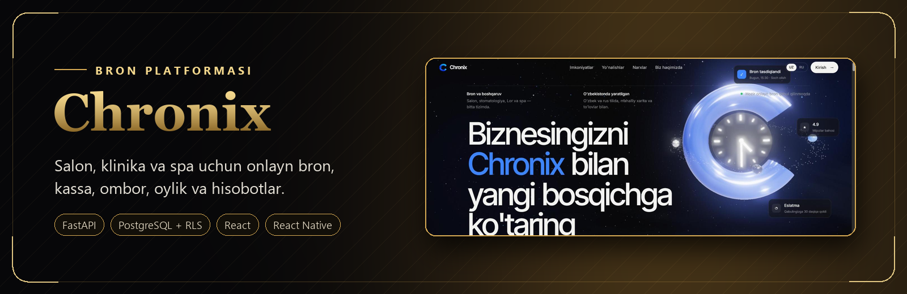
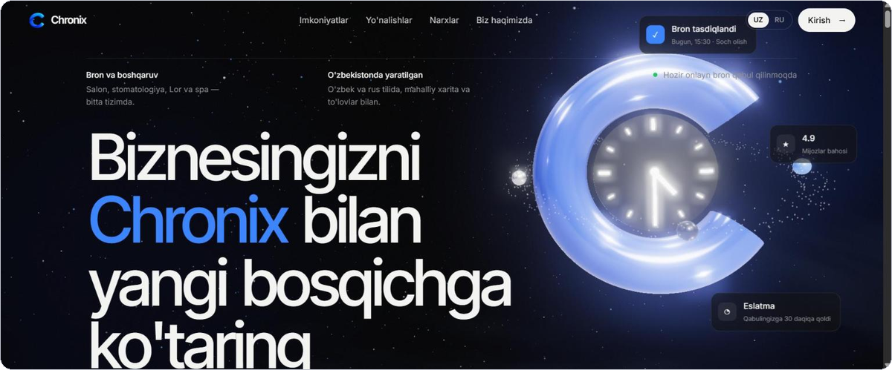
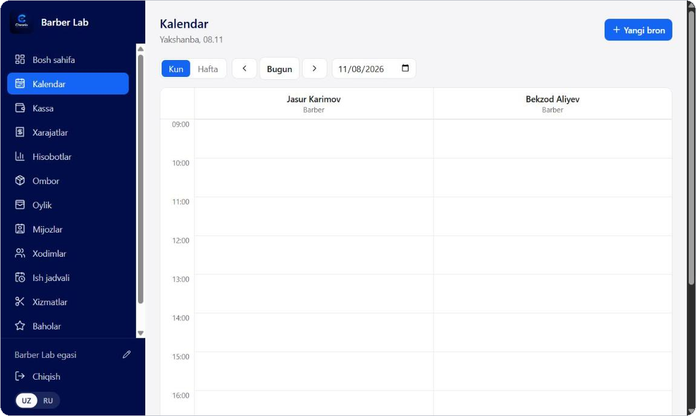
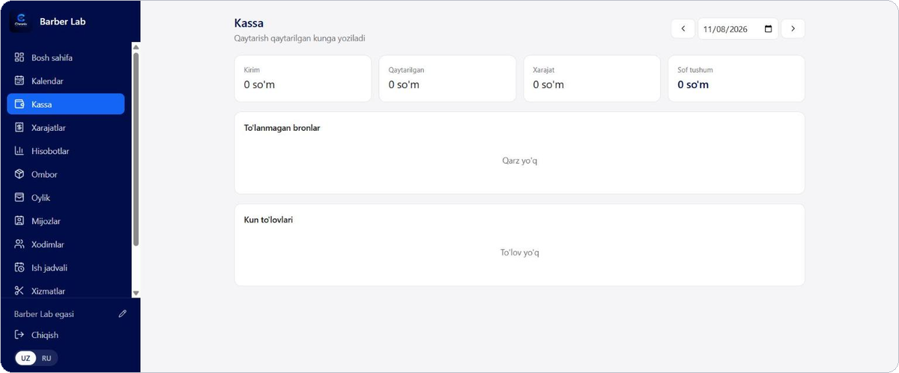
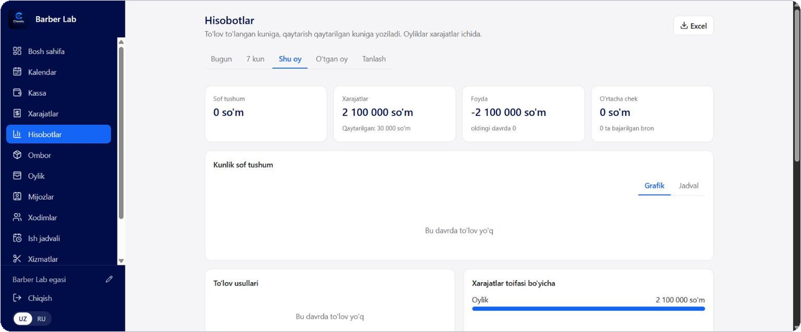
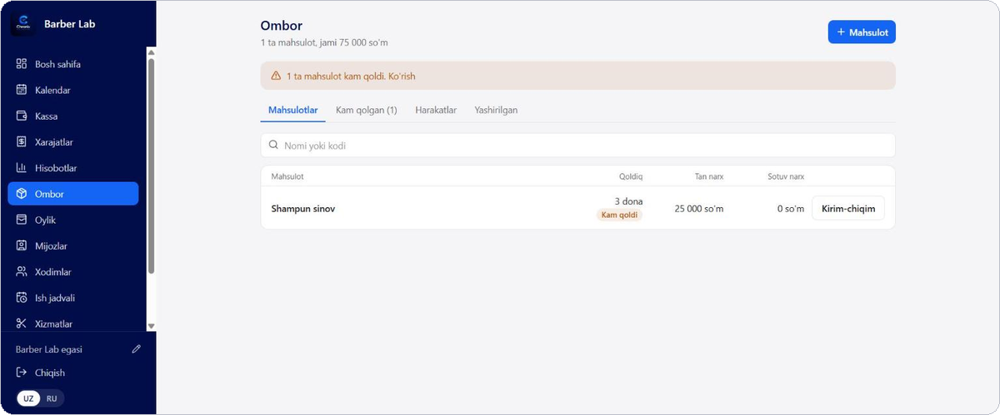
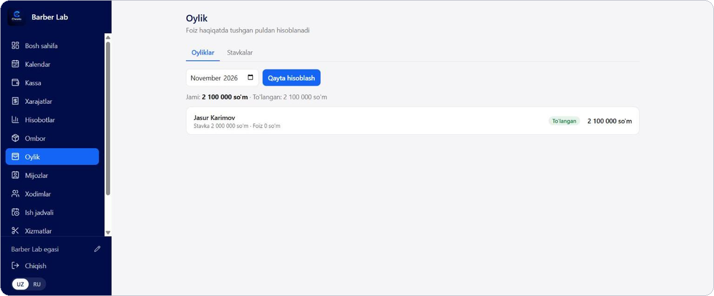
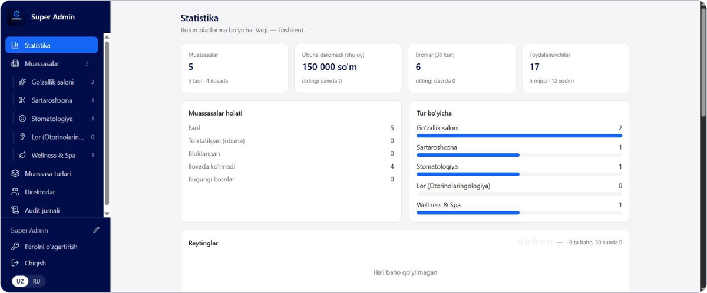
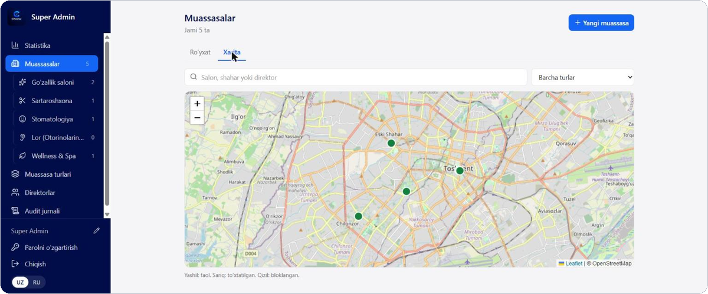

<p align="center">
  <a href="https://ariqalqon.uz"></a>
</p>

<h1 align="center">Chronix</h1>

<p align="center">
  <b>Vaqtingiz – bizning ustuvorligimiz.</b><br>
  Salon, klinika, stomatologiya va spa markazlari uchun onlayn bron va biznes boshqaruvi platformasi.
</p>

<p align="center">
  <a href="https://ariqalqon.uz"></a>
  
  
  
  
</p>

<p align="center">
  <a href="#imkoniyatlar">Imkoniyatlar</a> ·
  <a href="#ekranlar">Ekranlar</a> ·
  <a href="#arxitektura">Arxitektura</a> ·
  <a href="#ishga-tushirish">Ishga tushirish</a>
</p>

---

## Chronix nima

Chronix uch qismdan iborat bitta tizim:

- **Mobil ilova** — mijoz yaqin atrofdagi muassasani xaritadan topadi, xizmat va mutaxassisni tanlab, bo'sh vaqtga yoziladi.
- **Veb-panel** — direktor va xodimlar kalendar, kassa, ombor, oylik va hisobotlarni bitta joydan yuritadi.
- **Super Admin paneli** — platforma egasi muassasalar, obunalar, tariflar va audit jurnalini boshqaradi.

Interfeys o'zbek va rus tillarida. Muassasa turiga qarab so'zlar ham moslashadi: salonda "usta" va "mijoz", klinikada "shifokor" va "bemor".

## Imkoniyatlar

<table>
<tr>
<td width="50%" valign="top">

**Bron va qabulxona**
- Kunlik va haftalik kalendar, har bir mutaxassis alohida ustunda
- "Istalgan mutaxassis" — tizim eng kam band xodimni o'zi tanlaydi
- Tezkor qabul: yozilmasdan kelgan mijoz hozir bo'sh mutaxassisga
- Bitta tashrifga bir nechta xizmat, har biri o'z ijrochisi bilan
- Tasdiqlanmagan bron ish vaqtida avtomatik bekor bo'ladi

</td>
<td width="50%" valign="top">

**Pul va hisob**
- Kassa: qisman va oldindan to'lov, qaytarish, kunlik hisob
- Bo'limlar bo'yicha chek va chop etish
- Oylik: stavka, foiz, bonus, avans — foiz haqiqatda tushgan puldan
- Xarajatlar, hisobotlar va Excel eksport
- Onlayn obuna to'lovi (Payme, Click)

</td>
</tr>
<tr>
<td width="50%" valign="top">

**Ombor va xizmatlar**
- Mahsulotlar, kirim-chiqim, qoldiq nazorati
- Kamera orqali shtrix-kod skaneri
- Xizmat bo'limlari, mutaxassisga xos narx va davomiylik
- Ish jadvali, tanaffuslar va dam olish kunlari

</td>
<td width="50%" valign="top">

**Mijoz ilovasi**
- Xarita va joylashuv bo'yicha qidiruv, filtrlar
- Bron, ko'chirish, bekor qilish
- Budilnik ko'rinishidagi eslatma: "Boraman" / "Bormayman"
- Baho va sharhlar, sevimli muassasalar
- Ilova do'konisiz yangilanish (OTA)

</td>
</tr>
</table>

## Ekranlar

<p align="center"></p>

<table>
<tr>
<td width="50%"><p align="center"><b>Kalendar</b> — mutaxassislar bo'yicha kunlik jadval</p></td>
<td width="50%"><p align="center"><b>Kassa</b> — kunlik tushum, qarzlar, to'lovlar</p></td>
</tr>
<tr>
<td width="50%"><p align="center"><b>Hisobotlar</b> — tushum, xarajat, foyda</p></td>
<td width="50%"><p align="center"><b>Ombor</b> — mahsulotlar va qoldiq</p></td>
</tr>
<tr>
<td width="50%"><p align="center"><b>Oylik</b> — stavka, foiz, avans</p></td>
<td width="50%"><p align="center"><b>Super Admin</b> — platforma statistikasi</p></td>
</tr>
</table>

<p align="center"><br><b>Super Admin</b> — muassasalar xaritada</p>

> Ekranlardagi ma'lumotlar sinov bazasidan olingan.

## Arxitektura

```
mobile/    React Native (Expo) — mijoz ilovasi
web/       React + TypeScript + Vite — biznes paneli va Super Admin
landing/   Tanishtiruv sayti (3D)
backend/   FastAPI + PostgreSQL/PostGIS
  sql/       sxema, xavfsizlik siyosatlari va funksiyalar (manba shu yerda)
  tests/     haqiqiy PostgreSQL ustida ishlaydigan testlar
deploy/    Docker Compose, Caddy, o'rnatish va yangilash skriptlari
```

**Xavfsizlik bazaning o'zida hal qilinadi.** Har bir jadvalda Row Level Security yoqilgan: muassasa faqat o'z ma'lumotini ko'radi, xodim faqat o'z huquqi doirasida ishlaydi. Pulga tegishli yozuvlar (to'lov, oylik, avans, tashrif xizmatlari) to'g'ridan-to'g'ri o'zgartirilmaydi — faqat bazadagi funksiyalar orqali, ular narx va summani o'zi hisoblaydi. API'da xato bo'lsa ham, baza noto'g'ri yozuvga yo'l qo'ymaydi; buni alohida testlar tekshiradi.

Batafsil: [`docs/ARXITEKTURA.md`](docs/ARXITEKTURA.md), [`backend/README.md`](backend/README.md).

## Ishga tushirish

```bash
# Backend (PostgreSQL + PostGIS kerak)
cd backend
python -m venv .venv
.venv/Scripts/python -m pip install -r requirements.txt
cp .env.example .env              # baza manzili va kalitlarni yozing
.venv/Scripts/python -m alembic upgrade head
.venv/Scripts/python -m uvicorn app.main:app --port 8000

# Veb-panel
cd web
npm install
npm run dev

# Mobil ilova
cd mobile
npm install
npx expo start
```

Testlar: `cd backend && .venv/Scripts/python -m pytest`

Serverga o'rnatish: [`deploy/`](deploy) papkasidagi `setup.sh` (birinchi marta) va `update.sh` (yangilash).

---

<p align="center">
  <a href="https://ariqalqon.uz">ariqalqon.uz</a> · Muallif: <a href="https://github.com/umud-xacer">@umud-xacer</a>
</p>
